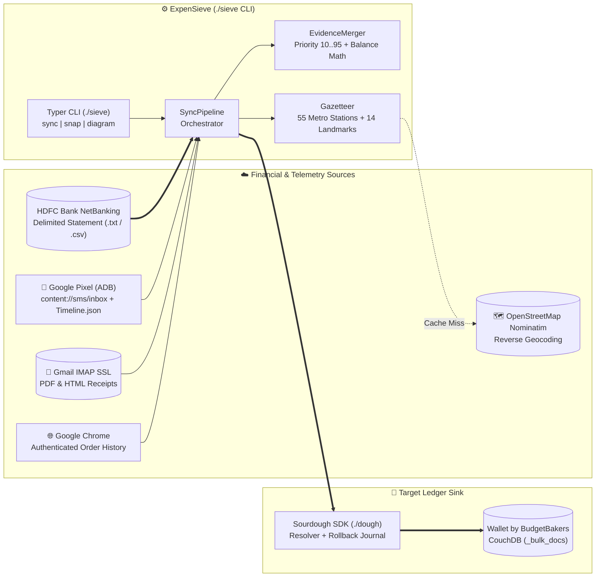
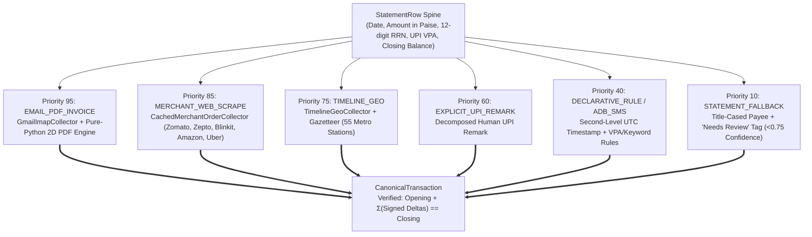
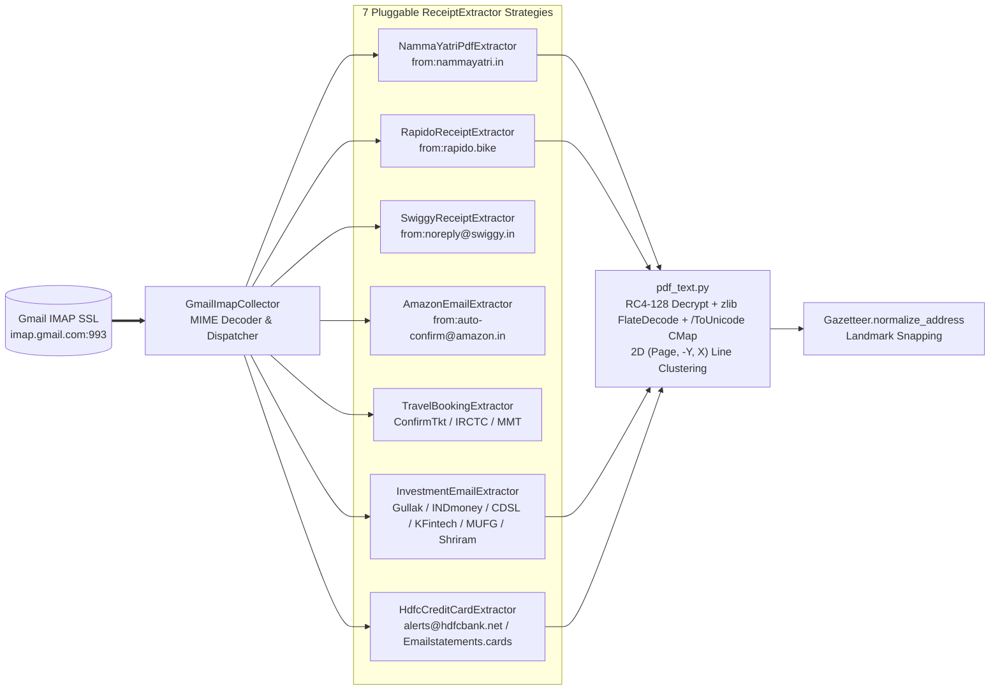

# ExpenSieve — Live System Architecture & Topology

> **Auto-Generated Architecture-as-Code:** This file and [`architecture/topology.c4`](architecture/topology.c4) are deterministically compiled from [`src/expensieve/domain/architecture.py`](src/expensieve/domain/architecture.py) via `./sieve diagram` and verified in CI by [`.github/workflows/architecture.yml`](.github/workflows/architecture.yml).

## Interactive Drill-Down Explorer (LikeC4 — 8 Views)

For the interactive, Google-Maps-style zoomable graph with **8 perspectives** (`index`, `hexagonal_view`, `collectors_view`, `gmail_pdf_view`, `domain_merger_view`, `sink_view`, `sync_pipeline_flow`, and `geo_snapping_flow`):

```bash
# Regenerate topology and ARCHITECTURE.md at any time:
./sieve diagram

# Verify architecture files are in sync (used in CI):
./sieve diagram --check

# Launch the interactive LikeC4 web explorer locally:
npx likec4 start architecture

# Or build a standalone static HTML site (automated via GitHub Actions -> GitHub Pages):
npx likec4 build architecture --base /expensieve/ -o dist/architecture
```

---

## 1. Overarching System Landscape (Level 1–2)



---

## 2. Multi-Source Evidence Priority Hierarchy (`EvidenceMerger`)



| Priority | Enum | Adapter / Collector | Extracted Enrichment |
| :--- | :--- | :--- | :--- |
| **`95`** | `EMAIL_PDF_INVOICE` | `GmailImapCollector` + `pdf_text` | **Namma Yatri** (`invoice_*.pdf`), **Rapido** (`AUTO/CAB_RECEIPT_*.pdf`), **Swiggy** dishes, **Amazon** shipments/pharmacy, **ConfirmTkt/IRCTC/MakeMyTrip** bookings, **Shriram Finance FD & IPO** advices, **HDFC Credit Card** InstaAlerts & encrypted PDF statements |
| **`85`** | `MERCHANT_WEB_SCRAPE` | `CachedMerchantOrderCollector` | **Zomato** restaurant + dish names, **Zepto** & **Blinkit** itemized groceries/pharmacy, **Amazon** order cache, **Uber** (`Auto` vs `Cab` routes & cancellation fees) |
| **`75`** | `TIMELINE_GEO` | `TimelineGeoCollector` | **Namma Metro** station-to-station routes (`Metro, <Origin> to <Dest>`), Auto/Cab GPS routes, and local QR merchant place names via `Gazetteer` + `Nominatim` |
| **`60`** | `EXPLICIT_UPI_REMARK` | `DeclarativeRuleCollector` | Human-written UPI remarks decomposed from statement narrations |
| **`40`** | `DECLARATIVE_RULE` | `AdbSmsCollector` / `DeclarativeRuleCollector` | Exact second-level UTC timestamps via 12-digit UPI RRN matching + VPA/keyword categorization |
| **`10`** | `STATEMENT_FALLBACK` | `HdfcDelimitedStatementSource` / `HdfcCreditCardPdfStatementSource` | Raw payee title-casing and `Needs Review` tag when confidence `< 0.75` |

---

## 3. Gmail IMAP & Pure-Python 2D PDF Extractor Pipeline



| Extractor | Query Filter | Attachment / Body Format | Output Note Format & Category |
| :--- | :--- | :--- | :--- |
| `NammaYatriPdfExtractor` | `from:nammayatri.in` | `invoice_*.pdf` (Multi-page PDF) | `Auto, <Origin> to <Dest>` (`Taxi, Cab`) |
| `RapidoReceiptExtractor` | `from:rapido.bike` | `AUTO/CAB_RECEIPT_*.pdf` + HTML | `Auto/Cab, <Origin> to <Dest>` (`Taxi, Cab`) |
| `SwiggyReceiptExtractor` | `from:noreply@swiggy.in` | HTML / Plaintext table | `<Dish 1>, <Dish 2> (<Restaurant>)` (`Restaurant, fast-food`) |
| `AmazonEmailExtractor` | `from:auto-confirm@amazon.in` | Shipment confirmation emails | `<Item 1>, <Item 2>` (`Pharmacy`, `Groceries`, `Electronics`, `Shopping`) |
| `TravelBookingExtractor` | `ConfirmTkt / IRCTC / MakeMyTrip` | Booking confirmation emails | `Train to <Dest> (<Train>, <Class>, PNR <PNR>)` (`Holiday, trips, hotels`) |
| `InvestmentEmailExtractor` | `Gullak / INDmoney / CDSL / KFintech / MUFG / Shriram` | Gold certs, US Stocks `.xls`, Contract Note `.pdf`, MF & IPO/REIT advices | Transfer to `Investments` (`Gullak Gold+`, `US Stocks`, `Indian Stocks`, `Mutual Fund`, `IPO/REIT`) & `Interests, dividends` |
| `HdfcCreditCardExtractor` | `alerts@hdfcbank.net / Emailstatements.cards` | Encrypted RC4-128 CC PDF + InstaAlerts | Exact UTC timestamps + Transfer to `HDFC Credit Card` |
